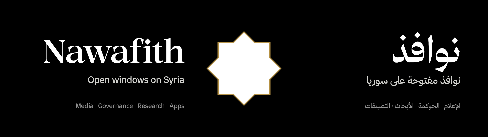

<picture>
  <source media="(prefers-color-scheme: dark)" srcset="./banner-dark.png">
  <source media="(prefers-color-scheme: light)" srcset="./banner-light.png">
  
</picture>

---

Syria has been read through rumours, leaks and other people's summaries for a long time. Nawafith puts the sources themselves in one place: what the media reports, what the state publishes in its Official Gazette, what researchers write, and which jobs, grants and tenders are open today. Arabic and English, side by side, each record linked back to where it came from.

نوافذ مفتوحة على سوريا: ما تنشره وسائل الإعلام، وما تصدره الدولة في جريدتها الرسمية، وما يكتبه الباحثون، والوظائف والمنح والمناقصات المفتوحة اليوم. بالعربية والإنكليزية معاً، وكلّ سجلّ مربوط بمصدره.

---

### The windows

| | |
|---|---|
| **[Media](https://media.nawafith.net/en)** · الإعلام | Syrian and international media as it happens: 143,000 articles from 1,400+ outlets and Telegram channels, across all 14 governorates. |
| **[Governance](https://gov.nawafith.net/en)** · الحوكمة | The Official Gazette as open records, 2000 to today: decrees, persons, companies and civil society, cross-linked and cited to the issue they appeared in. |
| **[Research](https://research.nawafith.net)** · الأبحاث | What think tanks, institutes and university centres publish about Syria, collected daily. |
| **[Education](https://education.nawafith.net/en/)** · التعليم | Scholarships, fellowships and courses for Syria's students and researchers, read from the pages of the bodies that offer them. |
| **[Sijill](https://sijill.nawafith.net)** · سجلّ | The fingerprint of every Gazette scan we hold, anchored on Ethereum and kept on Arweave and Swarm, so anyone can check that nothing was changed. |

### The apps

One app for all of it: the Wire, the day's top stories told by five voices (official, national, local, regional Arab, international), the Gazette issue by issue, the Syrian pound against the dollar, euro, lira and gold, and public tenders with their deadlines.

| Platform | Status |
|---|---|
| **Windows** | Available: [Microsoft Store and direct download](https://nawafith.net/software), version 1.0.6 |
| **Mac** | In review at Apple: a full window, and a panel at the top of the screen |
| **iPhone** | Next: the dollar rate and tender countdowns on the Lock Screen |
| **iPad** | After iPhone |
| **Android** | Planned, through Google Play |

No accounts, no ads, no trackers. Nawafith is independent and tied to no government or party.

### Open data

- **[Syrian Official Gazette dataset](https://doi.org/10.5281/zenodo.24122383)**: citable on Zenodo, CC BY-SA 4.0.
- **[nawafith-gazette-data](https://github.com/karam2022/nawafith-gazette-data)**: companies, decrees and decisions from the Gazette, each linked to its page on gov.nawafith.net.
- **[nawafith-starter](https://github.com/karam2022/nawafith-starter)**: a bilingual kit for turning scanned documents into searchable records that keep their link to the original.

---

Built in Berlin by <a href="https://github.com/karam2022">Karam Alhamad</a>, from Deir ez-Zor. · بُني في برلين.

